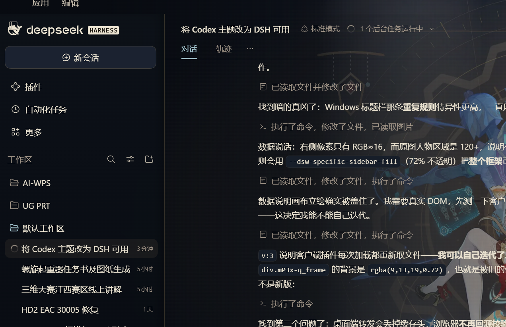
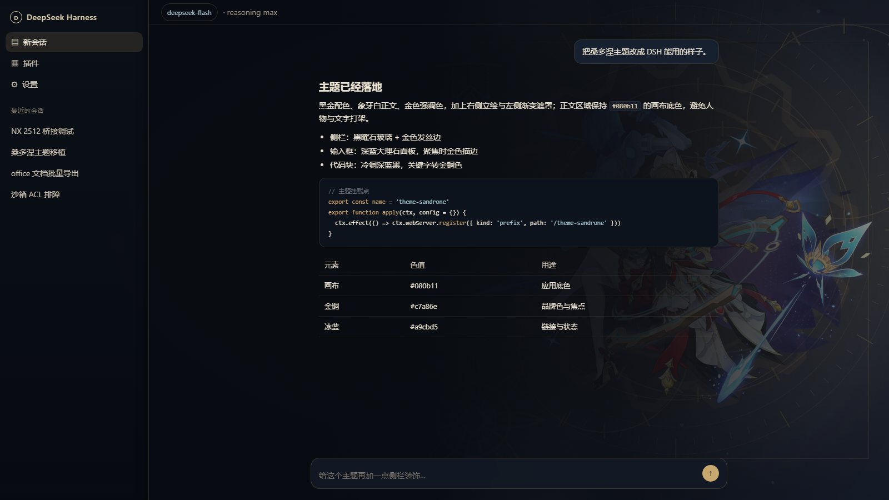
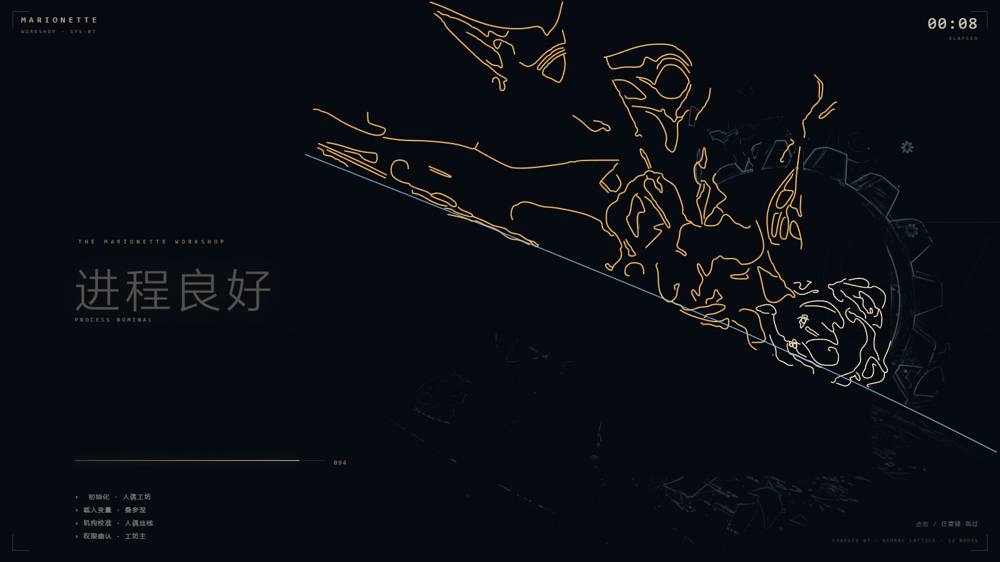
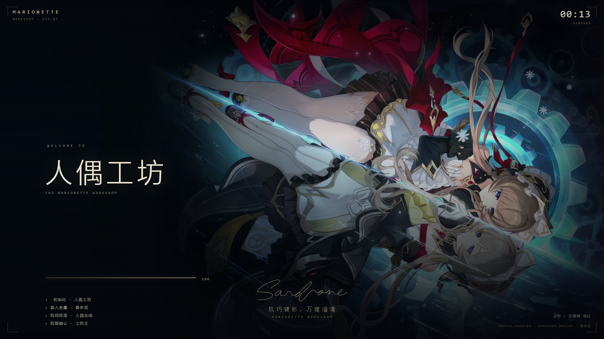

# Sandrone · 人偶工坊

> 把「桑多涅」的 Codex 皮肤，移植成 **DeepSeek Harness Web GUI** 可以直接安装的黑金深色主题。




## 这是什么

原皮肤 [fengye337/sandrone-codex](https://github.com/fengye337/sandrone-codex) 是给 Codex 桌面端做的：它靠 CDP 注入、`[data-ds-part]` 选择器和一整套启动器/原生窗口代码工作。DSH 的界面是完全 token 驱动的（`--dsw-*` 设计变量），所以这里的改造思路不是搬 CSS，而是**把同一套设计语言重新落到 DSH 的 token 体系上**：

| 原皮肤 | 本主题 |
| --- | --- |
| `theme.json` 的 colors | `--dsw-alias-*` / `--dsw-specific-*` 覆盖 |
| `background.png` 人物背景 | `/theme-sandrone/background.webp`，铺在应用画布上 |
| `[data-ds-part="message"]` 等安全 CSS | DSH 组件本身已由 token 驱动，不需要逐个组件改样式 |
| CDP + 启动器 + 原生窗口 | DSH 插件：宿主半边（资源路由）+ 浏览器半边（注入样式与深色调色板） |

仓库里有三个包：

| 目录 | 作用 |
| --- | --- |
| `dsh-theme-sandrone/` | 主题本体：黑金配色、桑多涅立绘、玻璃侧栏、电影式开屏 |
| `dsh-plugin-sandrone/` | 可选的左侧栏「桑多涅工坊」入口：主题状态、配色、重播开屏 |
| `dsh-plugin-sandrone-persona/` | 对话语气：可开关的系统提示段，让回复带上桑多涅的口吻 |

## 特性

- **黑金配色**：深蓝黑画布 `#080b11`、象牙白正文 `#ebe3d1`、金铜品牌色 `#c7a86e`、冰蓝链接 `#a9cbd5`、绯红强调 `#993e50`。
- **桑多涅立绘**：铺在窗口右侧，左侧用渐进遮罩压暗，保证正文可读（对应原皮肤的 `art.safeArea: "left"`）。
- **玻璃侧栏**：半透明黑曜石 + 金色发丝边框 + 背景模糊。
- **深蓝输入框**、金色焦点环、金色滚动条、暖色代码块配色。
- **电影式开屏**：4K 立绘 + 金线描边 + 启动 HUD（进度、时钟、诊断行）+ 命中音效 + 语音/配乐；点击或任意键跳过，每个页面会话只播一次。
- **桑多涅语气**：可开关的系统提示段，让回复带上人偶工坊主人的口吻；代码、路径、报错仍保持精确。
- **只读工坊面板**：侧栏点开可看主题是否真的挂载、复制诊断 JSON、重播开屏。
- **深色专用**：启用期间会钉住 `body[data-ds-dark-theme]`，因为原皮肤就是 `"appearance": "dark"`；禁用后立即回到 DSH 原生外观。

## 要求

- **DSH 0.2.1-rc.3** 或更高版本（Web GUI）。
- Windows 桌面端已验证；纯浏览器 `dsh web` 同样可用。
- 一键安装脚本需要 PowerShell 7（`pwsh`）。macOS / Linux 可按[手动安装](#手动安装macos--linux)操作。

## 安装

### 一键安装（主题 + 侧栏入口 + 语气）

把仓库克隆或下载 ZIP 解压后，在仓库根目录运行：

```powershell
pwsh -File .\install.ps1
```

不想用 git？到 [Releases](../../releases/latest) 下载 `dsh-theme-sandrone-0.4.0.zip`，解压后同样运行 `install.ps1`。

然后**完整退出 DSH 再打开一次**。客户端插件声明（`dsh.client`）按包名缓存到进程结束，这一步不能省。

脚本会：

1. 把主题复制到 `%USERPROFILE%\.dsh\themes\sandrone`，在 desktop profile 的 `node_modules` 里建 `dsh-theme-sandrone` junction；
2. 把侧栏入口复制到 `%USERPROFILE%\.dsh\plugins\sandrone-hub`，建 `dsh-plugin-sandrone` junction；
3. 把语气插件复制到 `%USERPROFILE%\.dsh\plugins\sandrone-persona`，建 `dsh-plugin-sandrone-persona` junction；
4. 在 `cordis.patch.yml` 末尾各追加一条 `insert` 条目（先备份，已存在则跳过）；
5. 清理 `package.json` / patch 的 UTF-8 BOM（DSH 启动时对 BOM 是 fatal）。

### 只装主题

```powershell
pwsh -File .\dsh-theme-sandrone\install.ps1
```

### 用 DSH 插件管理器

三个包都是标准 bundle（`package.json` 的 `dsh.bundle.patch` 指向各自的 `cordis.patch.yml`）。在插件管理器里选择「安装本地 bundle / 安装文件夹」，指向对应目录即可；装完建议完整重启一次。

### 手动安装（macOS / Linux）

1. 复制 `dsh-theme-sandrone/` 到 `~/.dsh/themes/sandrone/`。
2. 建立链接 `~/.dsh/profiles/desktop/node_modules/dsh-theme-sandrone` → 该目录。
3. 在 `~/.dsh/profiles/desktop/cordis.patch.yml` 末尾追加：

   ```yaml
   - insert:
       - id: theme-sandrone
         name: dsh-theme-sandrone
   ```

4. 完整退出并重新打开 DSH。

侧栏入口同理：复制 `dsh-plugin-sandrone/` 到 `~/.dsh/plugins/sandrone-hub/`，链接为 `dsh-plugin-sandrone`，patch row 的 id 为 `sandrone-hub`。语气插件：复制 `dsh-plugin-sandrone-persona/` 到 `~/.dsh/plugins/sandrone-persona/`，链接为 `dsh-plugin-sandrone-persona`，patch row 的 id 为 `sandrone-persona`。

### 验证

- 侧栏出现「桑多涅工坊」→ 入口已加载；点开后能看到主题状态卡片。
- 也可以直接查自检路由：

  ```text
  http://127.0.0.1:<GUI端口>/theme-sandrone/status
  http://127.0.0.1:<GUI端口>/sandrone-hub/status
  http://127.0.0.1:<GUI端口>/sandrone-persona/status
  ```

  `/theme-sandrone/status` 返回 `theme: "sandrone-marionette"`、样式表命中次数和页面回传的实况（深色属性、框架背景、DOM 轮廓、选择器命中数）。`/sandrone-persona/status` 返回当前语气开关；访问 `/sandrone-persona/toggle` 可以立即切换（下一条回复生效）。

### 卸载

```powershell
pwsh -File .\uninstall.ps1           # 移除三个 patch row 和 junction，文件默认保留
pwsh -File .\uninstall.ps1 -Purge    # 连同 ~/.dsh/themes/sandrone 与 ~/.dsh/plugins/{sandrone-hub,sandrone-persona} 一起删除
```

## 预览

顶部即 Windows 桌面端实机（1280 宽）。下面是离线预览页，用来单独验证配色和立绘位置：



启动 HUD 与金线描边（8.0s）：



显色后的「人偶工坊」（11.6s）：



开屏的节奏：

| 时间 | 画面 |
| --- | --- |
| 0–1.5s | 黑场；手写签名「Sandrone」逐笔画出；品牌与时钟 HUD 出现 |
| 1.5–9.6s | `trace.mp4` 的蓝色齿轮/水纹作底；金线逐笔描出立绘；启动 HUD 依次显示「解算开始 / 载入变量 / 机构校准 / 进程良好 / 析构万理」，进度、时钟、诊断行同步推进 |
| 9.6s | 命中：4K 立绘显色 + 金色闪光 + 「机巧镀形」+ 进度 100% |
| 11.25s | `WELCOME TO` / 「人偶工坊」 |
| 12.9s | 签名、`机巧镀形，万理澄清`、`ACCESS GRANTED` |
| 16.0s | 整层淡出，交出工作界面 |

点击 / `Esc` / `Enter` / 空格跳过，22 秒硬兜底。地址带 `#opening` 可强制重播。配音在 4.25s / 5.65s / 7.05s / 9.75s / 11.45s 落点，和 HUD 文案对齐；公开版只带配乐，本地版才混入语音（见[素材、许可与声明](#素材许可与声明)）。

## 工作原理

DSH 桌面端的主窗口不是用 `http://127.0.0.1:<port>/` 加载的，而是走 `dsh-app://app/` 自定义协议；宿主在**启动时**采集一次 index 注入行，之后不再刷新。所以只做 index 注入在桌面端会「装上了但没反应」。

- **宿主半边** `lib/index.js`：注册 `/theme-sandrone/*` 静态资源路由（CSS、立绘、开屏视频、自检 beacon），并额外贡献 index 注入行（纯浏览器 `dsh web` 场景的首屏兜底）。
- **浏览器半边** `lib/client.js`：`dsh.client` 声明的客户端插件，随模块图进页面，挂载时注入样式表并把 `data-ds-dark-theme` 钉住。桌面端和浏览器都走这条路，两条路重复注入时按 URL 去重。

两半都会检查「样式表是否已存在」，所以无论哪条先到，页面里只有一份主题。

### 几个踩出来的约束

1. **立绘必须画在画布上，不能画在框架上。** 桌面端窗口用 `dsh-app://app/` 而不是 HTTP 加载，框架外层还套着 `display: contents` 的 provider；任何「找到框架元素再上色」的写法都会因为层级变化失效。现在 `html` 铺满立绘，`--dsw-alias-bg-base` 改成透明，凡是拿它铺底的地方都会透出来。
2. **`--dsw-specific-sidebar-fill` 不能是半透明以上。** Windows 自定义标题栏那条规则（`[data-windows-titlebar] .frame`）会用这个 token 把**整个框架**再刷一遍，立绘会被压到 RGB 16 以下。它现在是全透明，侧栏自己有独立渐变。
3. **样式表链接必须带版本号。** 桌面端把宿主响应通过自定义协议转发，会丢掉 `cache-control` / `etag`，浏览器于是永不回源校验——改了 CSS 页面还是旧的。`lib/client.js` 每次加载都用 `?v=<时间戳>` 重新挂载。
4. **绝不在 React 的树里增删节点。** 侧栏图标全部用纯 CSS 覆盖（伪元素 + `visibility`），早期用 `replaceChild` 换图标会让 React 下一次协调找不到节点，整个「工作区」区块被卸载。
5. **开屏样式必须内联。** 带 `data-plugin-css` 的 `<style>` 会被客户端内核当成插件样式回收，布局整个失效（视频按 1920 原生尺寸铺开、签名掉出视口）。

## 自定义

| 想改什么 | 改哪里 |
| --- | --- |
| 颜色 | `dsh-theme-sandrone/theme/theme.css` 第 1 节（palette） |
| 立绘位置 / 浓度 | `theme/theme.css` 第 2 节（`background-position` / 遮罩渐变） |
| 换一张底图 | 覆盖 `dsh-theme-sandrone/assets/background.webp`（16:9，建议 ≤ 2560×1440） |
| 只保留配色、不要立绘 | patch 条目加 `config: { art: false }` |
| 保留立绘但尊重系统浅色外观 | patch 条目加 `config: { forceDark: false }` |
| 临时关掉 | 给 patch 条目加 `disabled: true` |

CSS 与 JSON 资源带 `no-cache` + ETag，改完刷新页面（Ctrl+R）即可看到，不用重装。

## 结构

```text
.
├── README.md
├── LICENSE                     # 代码 MIT
├── ASSET-LICENSE.md            # 第三方素材权利说明
├── THIRD-PARTY-NOTICES.md
├── CREDITS.md                  # 配乐 / 语音 / 上游署名
├── PROVENANCE.json             # 素材逐文件来源、SHA-256、转换说明
├── NOTICE.md
├── install.ps1 / uninstall.ps1 # 一键安装 / 卸载（三个包）
├── docs/                       # README 截图
├── preview/                    # 开屏离线预览页与本地静态服务
├── tools/
│   ├── build-opening-media.py  # 从 4K 视频/BGM/语音构建开屏美术与配乐
│   └── ...
├── dsh-theme-sandrone/
│   ├── package.json            # DSH bundle + client 声明
│   ├── cordis.patch.yml        # bundle 安装时插入的 row
│   ├── lib/index.js            # 宿主半边：资源路由 + Range + 自检
│   ├── lib/client.js           # 浏览器半边：注入样式、钉住深色、电影式开屏
│   ├── theme/theme.css         # 全部视觉：token 覆盖 + 画布立绘 + 阅读遮罩
│   ├── assets/                 # 立绘、开屏美术/配乐、描边数据、侧栏图标
│   ├── locale/                 # 插件管理器里的标题/说明
│   ├── tools/
│   │   ├── smoke.mjs           # 假 ctx 跑一遍宿主半边：路由、404、304、405、释放
│   │   └── audit-tokens.mjs    # 比对 token 名是否真实存在于 DSH 设计表
│   ├── install.ps1 / uninstall.ps1
│   └── README.md / NOTICE.md / LICENSE / ASSET-LICENSE.md / PROVENANCE.json
├── dsh-plugin-sandrone/
│   ├── package.json
│   ├── cordis.patch.yml
│   ├── index.js                # 宿主半边：/sandrone-hub/status
│   ├── client.js               # 浏览器半边：侧栏行 + 主面板
│   ├── icon.svg                # 原创齿轮图标
│   ├── locale/
│   ├── install.ps1
│   └── README.md
└── dsh-plugin-sandrone-persona/
    ├── package.json
    ├── cordis.patch.yml
    ├── index.js                # 系统提示 section + /sandrone-persona 控制路由
    ├── locale/
    ├── install.ps1
    └── README.md
```

## 开发与自检

主题包不带任何依赖，只用 Node 内置模块，也不会注册任何模型可见的工具或提示。

```powershell
node dsh-theme-sandrone/tools/smoke.mjs
node dsh-theme-sandrone/tools/audit-tokens.mjs <DSH 客户端包> [theme.css] [app.css]
# 或：DSH_CLIENT_BUNDLE=<客户端包> DSH_APP_CSS=<app.css> node dsh-theme-sandrone/tools/audit-tokens.mjs
```

- `smoke.mjs`：期望 `routes/rows` 正常、越界请求 404、`If-None-Match` 命中 304、非 GET 405。
- `audit-tokens.mjs`：比对 `theme.css` 里声明的 `--dsw-*` 等自定义属性是否存在于 DSH 设计表；同时扫描客户端包和 `app.css`，期望 `unknown 0`。

开屏可以脱离 DSH 单独预览（静态服务 + 真实的 `client.js`）：

```powershell
python preview/serve-opening.py        # http://127.0.0.1:52880/
```

重新生成开屏美术与配乐（需要 Python、numpy、ffmpeg；BGM 先转 48 kHz WAV）：

```powershell
# 公开配乐：只混 BGM + 合成音效
python tools/build-opening-media.py --bgm impact.wav --out dsh-theme-sandrone/assets/opening-score.m4a
# 本地配乐：额外混入语音片段（不提交到公开仓库）
python tools/build-opening-media.py --bgm impact.wav `
  --voice-clip clips/01.wav@4.25 --voice-clip clips/02.wav@5.65 `
  --voice-clip clips/03.wav@7.05 --voice-clip clips/04.wav@9.75 `
  --out dsh-theme-sandrone/assets/opening-score-local.m4a
```

## 兼容与排障

- 针对 DSH `0.2.1-rc.3` 验证。结构选择器只用了 `#root > div:first-child`（应用框架）和 `[class*="centerCol"|"rightbarCol"|"sidebarCol"|"composer"]`（CSS Module 类名的稳定后缀），小版本升级后大概率仍然有效。
- 升级后立绘 / 图标消失：多半是 DSH 改了 `centerCol` / `sidebarCol` / `composer` 等后缀或 token 名，改 `theme/theme.css` 对应选择器即可。
- DSH 起不来：检查 profile 的 `package.json` 和 `cordis.patch.yml` 是否有 UTF-8 BOM；安装脚本会自动清理。
- 侧栏入口没出现：先 `Ctrl+R`，再完整退出 DSH 重开。

## 素材、许可与声明

**代码 MIT，素材不是。** 请先读这一段再公开分发。

- 本仓库新增的 DSH 移植代码（`lib/`、`theme/theme.css`、安装脚本、语气提示文本等）：**MIT**，见 [LICENSE](LICENSE)。
- `dsh-theme-sandrone/assets/` 里的桑多涅角色图、开屏美术、签名与衍生素材：**不属于 MIT**，权利归原权利人，本仓库不提供额外再授权。
- 开屏配乐：Kevin MacLeod 的 *Impact Moderato*，**CC BY 4.0**；本仓库做了剪辑、叠加合成音效与混音，完整署名见 [CREDITS.md](CREDITS.md)。
- 开屏语音：从 B 站语音合集提取的片段，仅混入本地的 `opening-score-local.m4a`，**不随公开仓库发布**；语音权利归原权利人。
- 上游 [sandrone-codex](https://github.com/fengye337/sandrone-codex) 的 `ASSET-LICENSE.md` 明确说明素材来自用户提供的第三方美术；其 `asset-edition.json` 写明不授予公开再分发许可（`no public redistribution permission is granted by this code license`）。
- 因此本仓库默认只适合**个人本地使用**。若要公开传播、镜像或打包下载，请先取得相关权利人的许可，或移除 / 替换 `assets/` 中的第三方素材。
- 逐文件来源、SHA-256 与转换说明见 [PROVENANCE.json](PROVENANCE.json)，权利说明见 [ASSET-LICENSE.md](ASSET-LICENSE.md) 与 [THIRD-PARTY-NOTICES.md](THIRD-PARTY-NOTICES.md)。
- 配乐候选与试听链接见 [docs/bgm-options.md](docs/bgm-options.md)。

### 公开仓库前

- **可以直接公开**：`lib/`、`theme/theme.css`、安装脚本、语气提示文本、`opening-score.m4a`（CC BY 4.0，保留署名）、文档与构建脚本。
- **需要授权后才能公开**：`assets/` 里的桑多涅角色图、`opening-art.webp`、`trace.mp4`、`opening.json`（立绘描边数据）、`opening-score-local.m4a`（语音），以及含角色形象的截图。
- 如果要先做一个**合规的公开版**：移除上述素材并替换 `docs/` 截图；开屏会自动回退到 HUD + 配乐（`opening-art` 404 时只显示暗场与文字），主题仍可正常使用。
- 如果已经取得权利人的公开再分发许可，请把许可说明补进 `CREDITS.md`，再切换仓库可见性。

非官方同人主题，与 OpenAI、HoYoverse / COGNOSPHERE、DeepSeek 均无隶属或背书关系。

## English

A dark, token-driven port of the [`sandrone-codex`](https://github.com/fengye337/sandrone-codex) skin to the **DeepSeek Harness Web GUI**: black-and-gold palette, character artwork on the canvas, glass sidebar, and a 16-second cinematic boot (4K artwork, traced line-art, telemetry HUD, score). Companion bundles add a read-only "Sandrone Workshop" sidebar panel and a toggleable Sandrone persona.

- Requires DSH `0.2.1-rc.3+`; install with `pwsh -File .\install.ps1`, then fully restart DSH.
- The port code and persona text are MIT. The character artwork and opening visuals under `assets/` are **not** MIT and are not licensed for public redistribution; see [ASSET-LICENSE.md](ASSET-LICENSE.md).
- The opening bed is Kevin MacLeod's *Impact Moderato* (CC BY 4.0); see [CREDITS.md](CREDITS.md). Voice clips are local-only and never committed.
- Unofficial fan project; not affiliated with or endorsed by OpenAI, HoYoverse/COGNOSPHERE, or DeepSeek.
