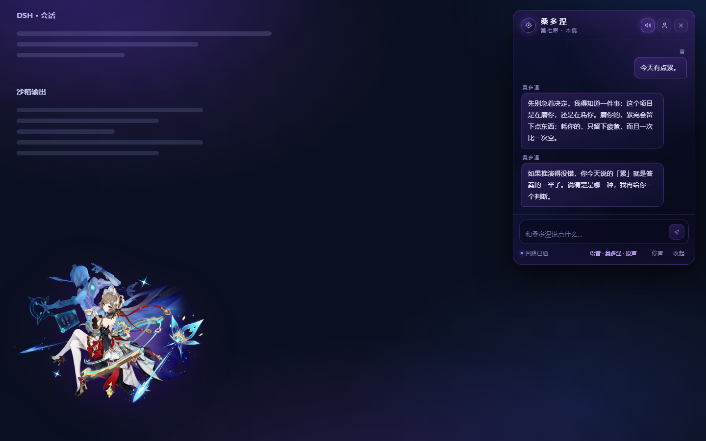
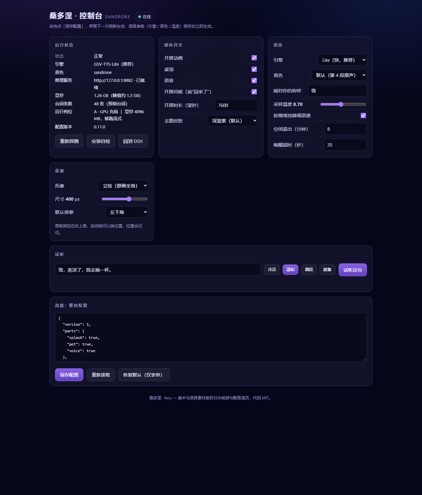
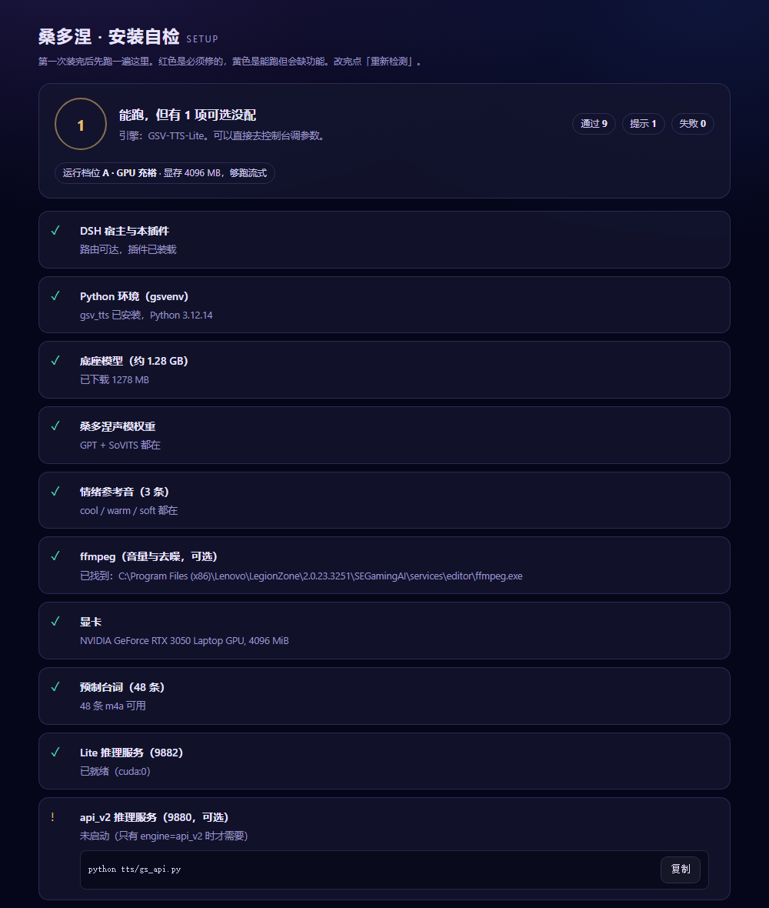
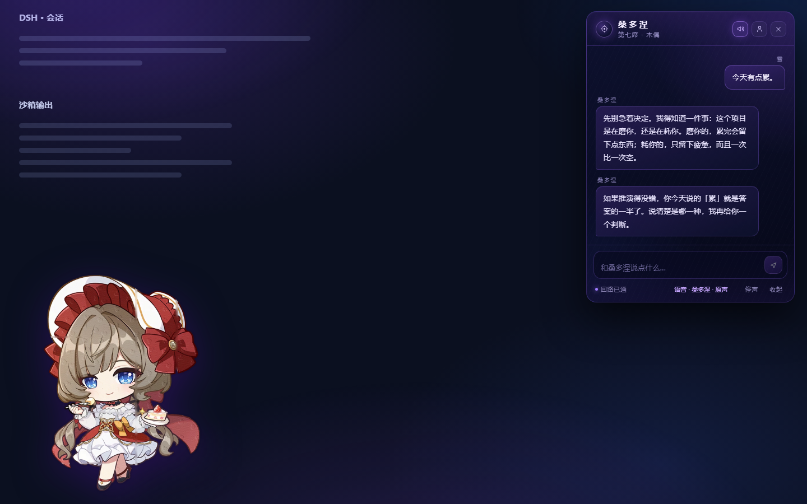

# Sandrone · 机偶 · Fairy

> **1.0.0 整合版**——本包已与工作台 `dsh-theme-sandrone` 完成接缝合并。开箱默认：黑金 `workshop` 皮肤、主题自带 16s 开屏（fairy 的 6.2s 电影开屏可配置开启）、`voice.mode=clips` 只播 48 条预制台词、称呼「你」。三个部件（splash / pet / voice）可用 `parts` 单独开关；控制台 `/sandrone/ui` 是静态页，不占 `parts`。

合作 B站 UP 主 [是雪夕捏](https://space.bilibili.com/662792249) 提供语音引擎、桌宠与控制台；本整合版由工作台黑金主题接缝合并。

把《原神》愚人众第七席「桑多涅」做成 **DeepSeek Harness** Web GUI 里的常驻伙伴：
一段电影式开屏、一只停在左下角的立绘桌宠、一个用她**自己声音**回答的对话面板。

不依赖任何云端语音服务——声音模型跑在你自己机器上，断网也能说话。


---

## 它长什么样

| 开屏（约 7 秒，可点击跳过） | 桌宠 + 对话面板 |
| --- | --- |
|  |  |

| 控制台（可视化调参） | 安装自检 |
| --- | --- |
|  |  |

桌宠有四套形象可以换（整张原画 / 侧坐 / Q 版甜点 / 嘟嘴大头），面板右上角那个人形图标就是切换键。



---

## 四个部件

整套是一个 DSH bundle，内部按块切开，每块都能单独关掉（`parts`）。整合版默认 `parts.splash=false`——开屏让给工作台主题的 16s 开屏，需要 fairy 的电影开屏时再单独打开：

| 部件 | 表现 | 代码位置 |
| --- | --- | --- |
| `splash` 开屏 | 4K 原画 6.2 秒镜头推进（齿轮特写 → 两人相拥 → 全景）→ 立绘弹入 → 标题 → **她开口问候** → 淡出进面板；整合版默认关，由主题开屏接管 | `client.js` 的 `SplashStage` / `.sdf-cine` / `.sdf-reveal` |
| `pet` 桌宠 | 左下角整张立绘（可拖拽、双击重播开屏），点开是玻璃拟态面板（默认钉右上角） | `client.js` 的 `Overlay` / `.sdf-fairy` / `.sdf-panel` |
| `voice` 语音 | 逐句流式：文字出现的同一刻那句话开始播；**导演层**先判情绪，四情绪池决定参考音 | `client.js` 的 `SPEAKER` + `index.js` 的 `/sandrone/tts` |
| `console` 控制台 | 网页版调参面板 + 安装自检 | `ui/index.html` / `ui/setup.html` |

对话走 `/sandrone/chat`：宿主半边用 `ctx.llm.stream()` 调当前默认模型，人格写在 `index.js` 的 `PERSONA_TEMPLATE`（称呼可配、克制不撒娇、不替用户操作终端）。

---

## 语音是怎么做到「像她」的

四层，缺一层都能听出来：

1. **音色**：GPT-SoVITS v2ProPlus 微调权重（`sandrone4_e1_s128.pth`，128 段语料 / 328 秒）。
2. **风格**：四情绪池 `cool / warm / tease / tired`，每池一条**风格参考音**（音色参考另行固定，两者解耦）。导演层让模型在回复首行写 `[[emo=warm]]`，服务端按池选参考音。
3. **推理**：GSV-TTS-Lite（CUDA Graph + KV Cache），本机 4096 MB 显存上首包 **0.21 秒**、RTF 0.28。
4. **对齐**：PCM 流式直传浏览器，文字按排定播放时刻出现，不是「先全出字再出声」。

固定台词（问候、低语、反应、时段）共 **48 条**已预先烘成 `.m4a`，零延迟；实时对话才现场合成。整合版默认 `voice.mode=clips`，只播这 48 条预制台词，切到 `auto` / `clone` 才拉起引擎实时合成。

---

## 安装

### 0. 先决条件

| 项目 | 要求 |
| --- | --- |
| DSH | ≥ 0.2.1-rc.3（`engines.dsh`） |
| Python | 3.10+（推荐 3.12） |
| GPU | 可选。有独显（≥3 GB 显存）走 A 档；没有也能跑，只是慢（C 档） |
| 磁盘 | 约 2.5 GB（底座模型 1.28 GB + 依赖） |

### 1. 装插件

**Windows：**

```powershell
powershell -ExecutionPolicy Bypass -File .\install.ps1
```

**Linux / macOS：**

```bash
bash ./install.sh
```

两条脚本做的事一样：复制到 `$DSH_HOME/plugins/sandrone-fairy` → 在 profile 的 `node_modules` 建链接 → 幂等追加 `cordis.patch.yml` 的一行 → 剥掉 UTF-8 BOM（DSH 对 BOM 会 fatal）。

也可以用插件管理器：

```
plugin_manager install_bundle   target = <这个目录的绝对路径>
```

装完**刷新页面**。改了 `index.js` 需要让 loader 重新挂载：

```
set_plugin {target:'include:sandrone-fairy', enabled:false}
set_plugin {target:'include:sandrone-fairy', enabled:true}
```

### 2. 装语音引擎

打开 **`/sandrone/setup`**（自检页），按红色项补：

```bash
# 依赖（首次约 2 GB，含 torch cu121）
python -m venv tts/gsvenv
tts/gsvenv/Scripts/pip install -r tts/requirements.txt   # Windows
# tts/gsvenv/bin/pip install -r tts/requirements.txt     # Linux/macOS
```

然后点自检页的 **「启动 Lite 服务」**（约 20 秒），或者让它在你第一次说话时自动拉起。

> 权重文件（`Sandrone-e30.ckpt` + `sandrone4_e1_s128.pth`，共 330 MB）**不在这个包里**——它们是从角色语音微调出来的，版权不属于我。自检页会告诉你缺哪个。想自己训一套，见 `INTEGRATION.md`。

### 3. 说一句话

整合版默认开屏由主题接管（fairy 电影开屏需开 `parts.splash`）、语音默认 `voice.mode=clips` 只播 48 条预制台词。想听她**实时用原声回答**：打开左下角立绘面板 → 把 `voice.mode` 切到 `auto`（或 `clone`）→ 打字。首次说话会等引擎拉起（5–20 秒），之后逐句流式出声。

---

## 配置

三种改法，优先级从低到高：

1. 控制台网页 `/sandrone/ui`
2. `POST /sandrone/config`（局部合并）
3. 直接编辑 `data/config.json`

| 键 | 默认 | 说明 |
| --- | --- | --- |
| `parts.splash` | `false` | 开屏开关（整合版默认关，由主题 16s 开屏接管；开启后播 fairy 6.2s 电影开屏） |
| `parts.pet` / `parts.voice` | `true` | 桌宠 / 语音开关（控制台是 `/sandrone/ui` 静态页，不在 `parts` 内） |
| `splash.greeting` | `true` | 开屏时是否念问候 |
| `splash.skipMs` | `7600` | 开屏总时长（4200–20000） |
| `pet.model` | `classic` | `classic` / `sit` / `cake` / `pout` |
| `pet.size` | `400` | 桌宠边长（160–560） |
| `pet.corner` | `bottom-left` | `bottom-left` / `bottom-right` |
| `voice.mode` | `clips` | `clips`（只播 48 条预制台词）/ `auto`（跟随作息实时合成）/ `clone`（锁原声实时合成）/ `off`（静音） |
| `voice.engine` | `api_v2` | `api_v2`（兼容旧链路，本机零样本可出声）/ `lite`（GSV-TTS-Lite，快，需微调权重） |
| `voice.timbre` | `sandrone` | 音色 ID（与风格解耦） |
| `voice.temperature` | `0.7` | 采样温度（0.3–1.2），越低越稳 |
| `voice.userName` | `你` | 她对你的称呼 |
| `voice.idleMs` / `voice.wakeMs` | `480000` / `35000` | 引擎空闲卸载 / 唤醒超时 |
| `ui.skin` | `workshop` | `workshop`（黑金，配合 `dsh-theme-sandrone`）/ `aurora`（本包深蓝紫） |

### 路径环境变量

整合版不再硬编码任何机器路径，Python / ffmpeg / 引擎定位都走环境变量，缺失时按「内置运行时 → PATH」顺序回退：

| 变量 | 用途 |
| --- | --- |
| `SANDRONE_PYTHON` | 运行语音脚本的 Python 解释器 |
| `SANDRONE_FFMPEG` | ffmpeg 可执行文件路径 |
| `SANDRONE_GS_API` | api_v2 引擎地址（默认 `http://127.0.0.1:9880`） |
| `SANDRONE_GS_REPO` | GPT-SoVITS 引擎树目录 |
| `SANDRONE_GS_PYTHON` | api_v2 链路的 Python |
| `SANDRONE_LITE_API` | GSV-TTS-Lite 服务地址（默认 `http://127.0.0.1:9882`） |

---

## 运行档位

启动后读一次显存，自己决定「要不要流式、一次念几句」：

| 档位 | 条件 | 行为 |
| --- | --- | --- |
| **A** | 显存 ≥ 3 GB | Lite + 流式，2 句 / 58 字 |
| **B** | 1.5–3 GB | Lite 非流式，2 句 / 40 字 |
| **C** | 无独显 / < 1.5 GB | Lite 走 CPU，1 句 / 24 字 |

`GET /sandrone/tier` 看判定结果；`?tier=B` 可以模拟低配。

---

## 预制台词

`assets/voice/` 里有 48 条烘好的台词（零延迟），分六组：

| 组 | 什么时候响 |
| --- | --- |
| `welcome` / `welcome-back` | 开屏问候；离开 2.5 小时以上再回来 |
| `greet-*` | 按时段打招呼（早/午/下午/傍晚/深夜） |
| `whisper-*` | 安静时的低语 |
| `idle-*` | 她闲着时按**时段**主动说一句；安静超过 45 分钟还有一句「你安静了挺久」 |
| `react-*` | 命中关键词（谢谢/累了/晚安/做完了/你好/夸赞/加班/吃饭…共 24 条规则）就先回一句，再接正式回复 |
| `farewell` | 收尾 |

主动开口的节奏：每 15 分钟查一次、30% 概率放行、两条之间至少隔 10 分钟；时段台词占 60%，通用低语占 40%；23:00–05:00 完全安静。

---

## 路由一览

| 路由 | 用途 |
| --- | --- |
| `GET /sandrone/ping` | 存活 + 当前 provider/model |
| `POST /sandrone/chat` | 对话（NDJSON 流，`{t:'delta'}` / `{t:'emo'}` / `{t:'done'}`） |
| `POST /sandrone/tts` | 合成（默认 wav；`{"stream":true}` 走 PCM 直传） |
| `GET /sandrone/voice` | 引擎 / 音色 / 池 / 参考音自检 |
| `GET /sandrone/tier` | 运行档位 |
| `GET/POST /sandrone/config` | 读 / 改配置 |
| `GET /sandrone/ui` | 控制台 |
| `GET /sandrone/setup` · `/setup/check` · `POST /setup/start` | 安装自检 / 一键拉起引擎 |
| `GET /sandrone/voices` | 48 条台词清单 |
| `GET /sandrone/asset/*` | 立绘、开屏原画、语音文件 |

---

## 常见问题

**开屏只播一次吗？** 每次刷新都播；双击桌宠可以重播。

**没声音？** 先看面板底部状态条：`桑多涅 · 原声` 表示正常；`原声未就绪` 表示引擎还没起来（第一次说话会等 5–20 秒）。再看 `/sandrone/setup` 的 Lite 那一条。

**没有显卡能跑吗？** 能，C 档，一句 8–12 秒，只念第一小句。模型 1.28 GB 走内存。

**能换别人的声音吗？** 能，`voice.timbre` 指向你自己的 GPT-SoVITS 权重即可，`INTEGRATION.md` 有步骤。

**为什么她不理我？** 23:00–05:00 是静音时段，只出字不出声；文字回复永远在。

---

## 授权

代码 MIT。**美术素材与语音版权归米哈游（miHoYo）与配音演员（洪海天）**，这个仓库不含训练权重。

不要把语音包或立绘当自己的作品再分发。详见 `NOTICE.md`。

## 致谢

- 合作 B站 UP 主 [是雪夕捏](https://space.bilibili.com/662792249)：语音引擎（GSV-TTS-Lite 双引擎）、四情绪池导演层、控制台、安装自检、档位降级与 48 条预制台词
- GPT-SoVITS 与 GSV-TTS-Lite 的作者
- 合作者 `dsh-theme-sandrone`（黑金主题、开屏 BGM、工坊侧栏）
- 参考过 B 站 UP 主「DJ鱼鱼君」的资料
